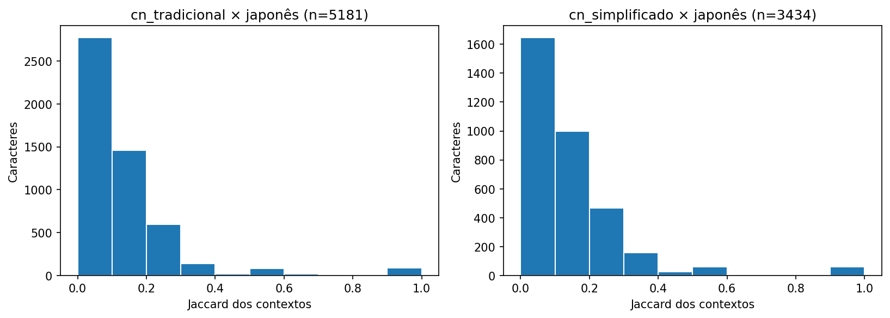
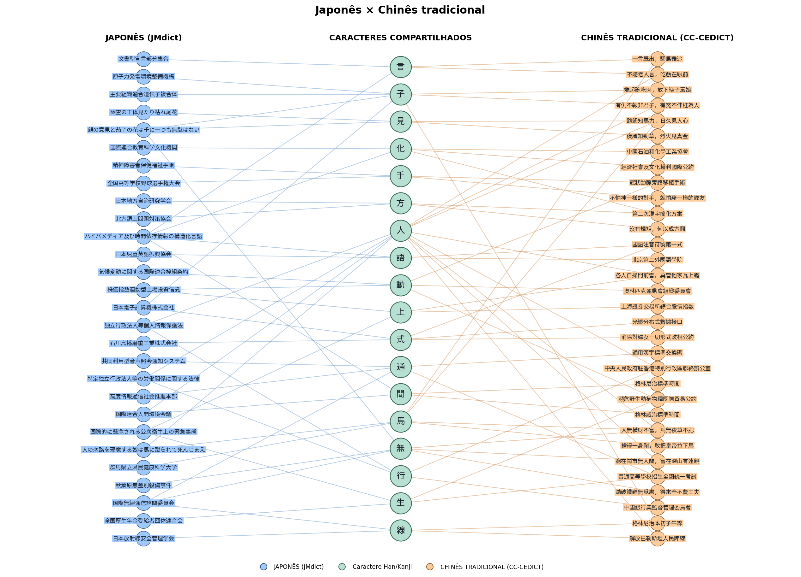

<sub>**Zhejiang International Studies University (ZISU)** — Hangzhou, China.</sub>

# L.O.T.U.S. (Linguística Oriental: análise das relações ortográficas entre japonês e chinês por meio da teoria dos grafos.)

Projeto da Unidade 1 de Algoritmos e Estruturas de Dados II. Redes de palavras e
caracteres construídas a partir de dois dicionários reais, com análise em um único
notebook: [LOTUS.ipynb](LOTUS.ipynb).

[](https://colab.research.google.com/github/39Matheus/AED2/blob/Work_Branch/LOTUS.ipynb)

## Integrantes

- Bárbara Lima Cordeiro da Silva ; 20220013738
- Mateus Vinicius Figueredo de Araújo; 20260000707
- Matheus Bezeril Pinto ; 20260000716

## Links Complementares

[LINK DO VÍDEO NO YOUTUBE](about:blank)

[Visualização dos Grafos Interativos do Projeto](https://mateus-vf-araujo.github.io/grafos_AED2/)

## Problema e pergunta

Normalmente, ouvimos que aprender uma nova língua pode ser difícil. No entanto, em muitos casos,
grafias, palavras e significados apresentam semelhanças entre diferentes idiomas. Reconhecer 
essas semelhanças entre a língua materna e uma nova língua pode facilitar o processo de aprendizado. 
Pensando nisso, apresentamos o L.O.T.U.S.

Neste trabalho, buscamos comparar o japonês com o chinês tradicional e o chinês simplificado, com o 
objetivo de demonstrar que, apesar de serem idiomas distintos, eles compartilham diversas características,
especialmente no que diz respeito aos seus caracteres. Para isso, utilizamos a teoria dos grafos para 
representar e analisar as relações entre os idiomas por meio dos caracteres que possuem em comum.

Em que medida os caracteres Han compartilhados entre o japonês e cada variante do chinês 
apresentam contextos ortográficos semelhantes nos dicionários analisados?
O resultado muda ao comparar o japonês com o chinês tradicional ou simplificado?

A estrutura da rede importa porque o contexto de um caractere é definido pelos
outros caracteres ligados a ele por palavras. O projeto permite explorar esses
contextos e inspecionar palavras/definições, sem exigir um sistema de tradução.

O código analisa como os caracteres se combinam nas palavras. As definições dos 
dicionários estão disponíveis para consulta, mas não entram no cálculo do Jaccard.

Por exemplo, 手紙 costuma significar “carta” em japonês e “papel higiênico” em chinês. 
As formas têm os mesmos caracteres: a rede que registra apenas palavra → caracteres não 
consegue reconhecer essa diferença de significado.

## Dados: fonte, obtenção e limpeza

- **CC-CEDICT:** dicionário chinês–inglês distribuído pelo
  [MDBG](https://www.mdbg.net/chinese/dictionary?page=cedict), com grafias
  tradicional/simplificada, pinyin e definições. O download vem do
  [arquivo oficial compactado](https://www.mdbg.net/chinese/export/cedict/cedict_1_0_ts_utf-8_mdbg.txt.gz).
- **JMdict:** dicionário japonês do
  [EDRDG](https://www.edrdg.org/jmdict/j_jmdict.html); usamos o
  [JMdict_e.gz](https://ftp.edrdg.org/pub/Nihongo/JMdict_e.gz), com definições inglesas.

As seções 3–4 do notebook baixam e processam os arquivos. As requisições têm
timeout e validação TLS/HTTP; o gzip é validado antes de ser salvo. O cache fica
em `data/raw/`, fora do Git. Para atualizar, remova os dois arquivos `.gz`.

O manifesto registra URL, tamanho, SHA-256 e primeira leitura de cada cópia.
Os arquivos oficiais mudam com o tempo: resultados idênticos exigem os mesmos
arquivos e parâmetros, não apenas a mesma semente. O registro desta execução está
em [resultados/execucao.json](resultados/execucao.json). No modo amostral, as unidades
selecionadas também são preservadas nos CSVs; no modo completo, os arquivos oficiais, seus
hashes e o código de limpeza permitem reconstruir a população elegível.

Limpeza:

1. Normaliza grafias com Unicode NFC; preserva diferenças entre variantes.
2. Ignora comentários do CC-CEDICT e reporta linhas não reconhecidas.
3. Preserva todas as grafias `keb` do JMdict e respeita restrições de grafia/leitura
   ao reunir definições. Formas sem Han ficam fora.
4. Agrupa sentidos repetidos por par de grafias chinesas e por grafia japonesa.
5. Com `USE_SAMPLE = False`, considera todas as unidades elegíveis após a limpeza.
   Com `USE_SAMPLE = True`, seleciona sem reposição, com semente 42, até `N_CN` pares
   chineses e `N_JP` grafias japonesas (5.000 por padrão).
6. Ao construir cada rede, reúne novamente as palavras por grafia da variante;
   cada caractere aparece uma vez por palavra, mesmo se repetido na escrita.

Definições agrupadas não alinham sentidos entre línguas. Os dicionários não são bases de dados de frequência e incluem nomes próprios, termos especializados e variantes.

## Modelagem

| Elemento | Definição e justificativa |
| --- | --- |
| Nós de palavra | Uma forma escrita por idioma/variante; prefixos diferentes evitam fundir palavras chinesas e japonesas. |
| Nós de caractere | Um caractere Han; coincidência do código Unicode permite conectar as redes. |
| Aresta bipartida | A palavra contém o caractere; presença binária, sem direção e sem peso. |
| Grau do caractere | Número de formas escritas distintas que o contêm na seleção atual. |
| Grau relativo | Grau dividido pelo número de palavras da rede; ajuda a comparar tamanhos diferentes. |
| Projeção | Caracteres ligados por ocorrência numa mesma palavra; peso = quantidade de palavras distintas em comum. |
| Jaccard | Interseção/união dos vizinhos das projeções, no universo de caracteres compartilhados daquela comparação; ignora pesos. |
| Contextos vazios | Se a união é vazia, Jaccard fica indefinido (`NaN`). |
| Grau na projeção | Número de caracteres distintos que coocorrem com o caractere em palavras. |
| Força | Soma dos pesos de coocorrência com todos os parceiros; palavras longas contribuem para mais pares. |
| Número de núcleo | Maior `k` de um k-core que contém o caractere; mede inserção numa estrutura de conexões internas. |
| Clustering | Fração de pares de vizinhos também conectados; calculado na projeção, sem pesos. |

As métricas usam três grafos bipartidos puros: japonês, chinês tradicional e
simplificado. As duas variantes chinesas vêm dos mesmos pares selecionados.
Na visualização interativa simplificado × tradicional, um grafo separado recebe
arestas entre formas da mesma entrada do CC-CEDICT. Essas relações não entram na
densidade bipartida, nas componentes ou nas projeções analisadas.

Ficam de fora frequência de uso, ordem/repetição dos caracteres, conversão
automática entre variantes, alinhamento de sentidos e relações de tradução.

## Conteúdo do curso utilizado

As referências abaixo usam os títulos das seções, estáveis mesmo após inserir células.

| Conceito | Semana | Onde aparece em `LOTUS.ipynb` | Para que serviu |
| --- | --- | --- | --- |
| Grafo simples, atributos e subgrafos | 2 | §§1, 6 e 11–12; `build_word_character_graph` | Tornar explícitas as relações e separar a amostra visual da rede analisada. |
| Grau e densidade | 2 | §§7 e 9; `df_summary`, `compare_contexts` | Medir participação dos caracteres e densidade entre partições. |
| Componentes conexas | 4 | §7; `nx.connected_components` | Mostrar fragmentação e tamanho da maior componente. |
| Redes bipartidas | 6 | §6; `build_word_character_graph`, verificações de partições | Representar palavras e caracteres sem misturar tipos de relação. |
| Matriz de incidência | 6 | §8; `incidence_example` | Inspecionar presença de caracteres por palavra. |
| Projeção e coocorrência | 6 | §9; `project_characters`, matriz esparsa `B.T @ B` | Contar palavras compartilhadas por pares de caracteres sem formar uma matriz densa. |
| Jaccard | 6 | §9; `compare_contexts` | Adaptar a comparação de conjuntos para os vizinhos do mesmo caractere entre idiomas. |
| Grau na projeção e força | 6 | §9.1; `projection.degree`, `degree(weight="weight")` | Separar diversidade de parceiros e volume acumulado de coocorrências. |
| K-core, core number e degenerescência | 5 e 6 | §9.1; `nx.core_number` | Identificar inserção nos núcleos e tamanho do núcleo mais interno. |
| Clustering | 4 e 6 | §9.1; `nx.clustering` | Medir o fechamento entre parceiros, reconhecendo os cliques criados pela projeção. |

## Como executar

**Colab:** abra o link acima e execute todas as células na ordem. A seção 2 instala
as bibliotecas com versões fixadas. Para rótulos CJK, instale `fonts-noto-cjk`
se a fonte estiver ausente e reinicie o kernel. A análise funciona sem essa fonte.
Mesmo instalada, a fonte pode não cobrir algum Han raro das figuras; os caracteres
originais são preservados nas tabelas e nos cálculos.

**Localmente:** Python 3.11 recomendado. A partir da raiz do repositório:

```bash
python -m venv .venv
source .venv/bin/activate
python -m pip install -r requirements.txt
jupyter execute LOTUS.ipynb --inplace --timeout=1800
```

No Windows, ative com `.venv\Scripts\activate`. Alternativamente, abra o notebook
em seu ambiente Jupyter e execute todas as células. A primeira execução requer
internet; as demais reaproveitam o cache. Em Linux, a fonte pode ser instalada com
`sudo apt-get install fonts-noto-cjk` antes de iniciar o kernel.

Na seção 2, escolha o modo:

```python
USE_SAMPLE = False  # população completa: todos os registros elegíveis após a limpeza
N_CN = 5000        # estes limites só são aplicados se USE_SAMPLE = True
N_JP = 5000
SEED = 42
```

`USE_SAMPLE = True` permite uma execução menor e reproduzível. A configuração salva
usa `False`, como na execução com populações completas registrada abaixo. Não há
detecção automática de nuvem/Colab para mudar a seleção silenciosamente.
`MIN_SUPPORT = 3` na seção 9 filtra apenas os rankings; os CSVs de métricas preservam
todos os caracteres. `INTERACTIVE_INLINE = True` mantém os grafos no notebook.

As projeções são calculadas pela matriz esparsa de incidência (`B.T @ B`), com contagens
inteiras e diagonal removida. Grau, força, core e clustering são calculados exatamente
nas projeções da seleção inteira. As figuras continuam usando recortes legíveis.

### Seleção dos caracteres nos desenhos

O controle visual foi integrado da versão `LOTUS_top_frequency_para_manual.ipynb`
do grupo. Ele atua depois das análises e não filtra os dicionários, as projeções ou
as métricas globais. A configuração salva usa as listas manuais dessa versão:

```python
SHARED_CHAR_MODE = "manual"  # "top_frequency", "random" ou "manual"
SHARED_CHAR_COUNT = 18
SHARED_CHAR_SEED = 42
```

- **`top_frequency`:** prioriza o menor grau entre chinês e japonês, depois a soma
  dos graus e o caractere. Conta grafias distintas conectadas, não frequência de uso.
- **`random`:** sorteia até `SHARED_CHAR_COUNT` caracteres realmente compartilhados,
  com semente fixa.
- **`manual`:** usa `MANUAL_SHARED_CHARS_TRAD` e `MANUAL_SHARED_CHARS_SIMP`, separadamente.
  Preserva a ordem, remove duplicatas e avisa sobre caracteres ausentes de um dos
  idiomas na seleção atual. A lista inteira é considerada nesse modo.

Para fixar um ranking, execute com `top_frequency`, copie as duas listas Python
impressas na seção 11.1 para as variáveis manuais e mude para `manual`. As figuras
estáticas e as redes interativas respeitam a mesma seleção explícita. Os limites
`COMPARE_CHARS` e `INTERACTIVE_MAX_CHARS`, ambos em 18, podem reduzir somente o
número de caracteres desenhados; os limites de palavras por caractere também
continuam ativos para legibilidade.

Se alterar apenas os controles `SHARED_CHAR_*` ou as listas manuais, pode executar
novamente a configuração e as seções 11–13 para refazer os desenhos e seu registro. Se alterar
`USE_SAMPLE` ou os limites de dados, execute o notebook inteiro. A comparação
simplificado × tradicional mantém seu desenho de pares da mesma entrada e sua
seleção automática de caracteres na rede interativa.

As listas selecionadas, sugestões de ranking, contagens e ausências ficam em
[resultados/selecao_caracteres.json](resultados/selecao_caracteres.json). “Manual”
significa escolher caracteres para os desenhos; não é uma avaliação de significados.

Saídas:

- `resultados/limpeza.csv` e `resumo_redes.csv`: cobertura e estrutura.
- `resultados/amostra_cn.csv` e `amostra_jp.csv`: somente no modo amostral;
  no modo completo, são removidos para evitar confusão com resultados antigos.
- `resultados/contextos_*.csv` e `conclusoes.csv`: graus, contextos e Jaccard.
- `resultados/metricas_caracteres_*.csv` e `resumo_projecoes.csv`: grau da
  projeção, força, core, clustering e resumo das estruturas.
- `resultados/selecao_caracteres.json`: configuração e listas utilizadas nos desenhos.
- `resultados/selecao_qualitativa.csv`: ranking dos 20 caracteres para leitura qualitativa.
- [resultados/analise_qualitativa_20.csv](resultados/analise_qualitativa_20.csv): palavras,
  definições completas, excertos, interpretações preliminares e ressalvas das 20 fichas.
- `resultados/figuras/`: quatro PNGs gerados pelo código.
- [resultados/grafos/](resultados/grafos/): três HTMLs interativos incluídos no Git.
  As redes são embutidas no notebook por padrão (`INTERACTIVE_INLINE = True`).
  Execute no Colab/Jupyter para interagir ou baixe os HTMLs e abra no navegador.
  O visualizador de notebooks do GitHub não executa JavaScript.

## Resultados e interpretação

Execução verificada em IPython na nuvem, com todas as células em sequência (cerca de
quatro minutos e pico de 2 GB nesta máquina).

Execução com **`USE_SAMPLE = False`**: todos os **122.753 pares
chineses** e **227.076 grafias japonesas** elegíveis dos arquivos
registrados no manifesto. Esses totais já excluem formas sem Han e agrupam registros repetidos;
não equivalem à contagem de todas as linhas brutas nem a toda a população de usos das línguas.

| Rede bipartida | Palavras distintas | Caracteres | Arestas | Componentes | Nós na maior componente |
| --- | ---: | ---: | ---: | ---: | ---: |
| Chinês tradicional | 122.667 | 11.686 | 316.008 | 5.184 | 91,99% |
| Chinês simplificado | 121.481 | 10.771 | 314.481 | 4.484 | 92,92% |
| Japonês | 227.076 | 6.042 | 578.497 | 493 | 99,51% |

As duas redes chinesas podem ter quantidades diferentes de palavras, porque pares distintos
podem compartilhar uma grafia de determinada variante. Grau bipartido conta grafias contendo
um caractere, e grau relativo é a proporção dessas grafias no dicionário representado.
Uma maior componente grande indica que muitas palavras/caracteres podem ser alcançados por
cadeias de compartilhamento ortográfico; não implica semelhança de significado.

A densidade bipartida é baixa porque cada palavra contém poucos caracteres entre milhares
de possibilidades. Comparar apenas densidade ou número de arestas entre dicionários com
coberturas diferentes não permite concluir qual língua é mais rica ou usada.

| Projeção | Parceiros por caractere (média) | Força média | Clustering médio | Degenerescência | Caracteres no núcleo principal |
| --- | ---: | ---: | ---: | ---: | ---: |
| Chinês tradicional | 30,77 | 56,68 | 0,1808 | 105 | 427 |
| Chinês simplificado | 33,20 | 61,41 | 0,1903 | 107 | 356 |
| Japonês | 73,88 | 211,99 | 0,3498 | 170 | 395 |

**Como ler as novas métricas:** o grau da projeção conta parceiros distintos; a força
soma quantas palavras sustentam as coocorrências com esses parceiros. O número de núcleo
indica em que estrutura de conexões internas o caractere permanece após retirar periferias.
A degenerescência é o `k` do núcleo mais interno; todos os seus caracteres têm pelo menos
`k` parceiros nesse núcleo. Clustering é a proporção de pares de parceiros também ligados;
a média inclui zero para graus menores que dois. São medidas de organização ortográfica.

Há caracteres isolados nas projeções: 5.068 no tradicional, 4.369 no simplificado e
443 no japonês. Suas formas
contêm apenas um Han distinto. Eles continuam ligados a palavras na rede bipartida,
contam como componentes na projeção e contribuem com zero para a média de clustering.
Isso ajuda a interpretar a diferença de fragmentação e de médias entre dicionários.

Exemplos calculados nesta execução:

- **Chinês tradicional, 不:** aparece em 2.190 grafias, tem 1.562 parceiros e força 6.789. Seu número de núcleo é 105.
- **Chinês simplificado, 不:** aparece em 2.187 grafias, tem 1.543 parceiros e força 6.780. Seu número de núcleo é 107.
- **Japonês, 学:** aparece em 4.271 grafias, tem 1.207 parceiros e força 16.708. Seu número de núcleo é 170.

Uma mesma palavra pode contribuir para vários pares: palavras longas elevam força, core e
clustering por criarem cliques na projeção. Esses valores não contam sentidos e não demonstram
comunidades semânticas. A seção 10 mostra palavras, leituras e definições para inspeção.

| Comparação com japonês | Caracteres compartilhados | Jaccard definido | Média | Mediana | Jaccard zero | Com suporte ≥ 3 nos dois idiomas |
| --- | ---: | ---: | ---: | ---: | ---: | ---: |
| Chinês tradicional | 5.353 | 5.181 | 0,1204 | 0,0870 | 1.436 | 3.488 |
| Chinês simplificado | 3.599 | 3.434 | 0,1351 | 0,1053 | 909 | 2.475 |

Jaccard compara os conjuntos de parceiros do mesmo caractere entre idiomas, considerando
apenas o universo compartilhado daquela comparação. Um resultado de 0,20 significa que
20% dos parceiros na união dos contextos aparecem nos dois conjuntos; zero significa que
não há parceiro em comum nesse universo. Quando os dois contextos são vazios, o valor é
indefinido, não zero ou um. A tabela `conclusoes.csv` também informa a média após o filtro
de suporte, para que poucos registros não dominem a leitura dos rankings.

Na população completa, as médias de Jaccard são aproximadamente **12,04%**
(tradicional/japonês) e **13,51%** (simplificado/japonês). As medianas são menores:
**8,70%** e **10,53%**. Portanto, o caractere central da distribuição tem uma fração
relativamente pequena de parceiros compartilhados no universo considerado, embora
existam caracteres com sobreposição maior. Isso descreve combinações, não uma porcentagem
de equivalência de significados.

A resposta à pergunta é uma comparação de **contextos ortográficos dicionarizados**:
existem caracteres e combinações compartilhadas, com níveis de sobreposição distintos
mostrados nos rankings. Usar a população completa elimina a perda por amostragem desta
execução, mas não as diferenças editoriais e de cobertura das fontes. Jaccard baixo
continua sem demonstrar divergência de sentido; alto também não garante equivalência.
As comparações tradicional/japonês e simplificado/japonês usam universos diferentes, então
a diferença entre suas médias não isola um efeito da variante escrita.





## Análise qualitativa de 20 caracteres

As seções **10.1–10.2** do notebook acrescentam uma leitura de palavras e definições reais.
Vinte caracteres é um recorte viável para exploração e discussão, sem representatividade
estatística. Primeiro, ordenamos os caracteres compartilhados pelas três redes pelo menor
grau entre elas, do maior para o menor. Os desempates usam a soma dos graus e a ordem Unicode;
exigimos pelo menos três grafias em cada rede. Só depois escolhemos uma palavra ilustrativa
de mesma grafia no japonês e em uma das variantes chinesas para cada caractere.

O recorte da população completa é **子 大 人 不 一 山 水 中 心 生 地 天 自 性 小 家 白 海 有 化**.
Seu suporte mínimo nas três redes varia de **651 a 1.818 grafias**. Esse suporte conta grafias
distintas dicionarizadas, não frequência de uso. A seleção favorece caracteres bem documentados
e não foi feita para comparar extremos de Jaccard. Ela é independente das listas dos desenhos.

Cada ficha contém uma palavra distinta, o par tradicional/simplificado, leituras, todas as
glosas agrupadas pelo parser, excertos literais, interpretação e ressalva. A interpretação
é da **palavra e de suas acepções**, sem atribuir significado único ao caractere.

Alguns resultados dessa leitura:

- **火山**, para 山: ambas as fontes registram `volcano`, mostrando coincidência nesse sentido.
- **大家**, para 大: há sobreposição em especialista, mas o chinês também registra “todos”
  e o japonês, locador de imóvel. A palavra não cabe num rótulo único de igual ou diferente.
- **天井**, para 天: o chinês inclui pátio e átrio, mas também `caisson ceiling`; o japonês
  inclui teto e teto de preços. A oposição simples “pátio versus teto” esconderia essa sobreposição.
- **有料**, para 有: o CC-CEDICT registra `impressive`, enquanto o JMdict registra cobrança,
  pagamento e estrada com pedágio. Há um contraste nas entradas que merece exame em frases.
- **化学**, para 化: o sentido de química coincide, mas a grafia japonesa corresponde à forma
  chinesa simplificada; a forma tradicional da mesma entrada é 化學. Isso fica explícito na ficha.

As 20 leituras estão no notebook e no [CSV de evidências](resultados/analise_qualitativa_20.csv).
As notas foram redigidas com assistência de IA a partir dos verbetes, com conferência dos
excertos e das assinaturas SHA-256 das glosas pelo código;
**a revisão linguística pelo grupo permanece pendente**. Encontrar uma citação na fonte
confirma a evidência textual, sem validar por si só a interpretação.
Não foi acrescentado um classificador semântico nem uma nova dependência.

As palavras são exemplos escolhidos para discussão, não uma amostra aleatória de usos.
Não calculamos proporção de falsos cognatos nem correlação entre Jaccard e significado.
As definições agregam leituras e acepções; uma glosa ausente não prova que o sentido inexista
na língua. Frequência, registro, construções gramaticais e contexto ainda exigem consulta.
Ao mudar a amostra ou atualizar as fontes, o código sinaliza exemplos ausentes, caracteres
sem ficha e glosas alteradas, inclusive fora dos excertos citados, sem reaproveitar silenciosamente
interpretações sem evidência. As assinaturas de referência só devem ser atualizadas após rever as fichas.

## Limitações e próximos passos

- No modo amostral, vizinhos ausentes podem reduzir o Jaccard e fragmentar a rede.
  A execução completa elimina essa perda específica, mantendo os limites das fontes e do modelo.
- Os dicionários têm políticas editoriais e coberturas distintas. Igualar o número
  de unidades amostradas não iguala frequência ou familiaridade.
- As variantes japonesas entram como grafias distintas e os homógrafos se unem
  por escrita. Agrupar definições não resolve completamente polissemia e leituras.
- Compartilhar um código Unicode não significa compartilhar um significado;
  caracteres variantes não são convertidos automaticamente.
- A projeção perde a identidade das palavras e cria cliques para palavras longas.
  Por isso não inferimos comunidades semânticas a partir de triângulos.
- Os desenhos usam uma seleção explícita de caracteres e limitam palavras por caractere;
  as estatísticas usam toda a seleção atual, e o layout não é medida de similaridade.

## Referências e créditos

- CC-CEDICT e seus colaboradores, distribuído pelo [MDBG](https://www.mdbg.net/chinese/dictionary?page=cedict).
- JMdict, Electronic Dictionary Research and Development Group:
  [documentação](https://www.edrdg.org/jmdict/j_jmdict.html) e
  [licença](https://www.edrdg.org/edrdg/licence.html).
- Ambos os dicionários são distribuídos sob
  [Creative Commons Attribution-ShareAlike 4.0](https://creativecommons.org/licenses/by-sa/4.0/).
  Os CSVs de amostras e de análise qualitativa contêm dados derivados dessas fontes e mantêm esses créditos e licença.
- [NetworkX: redes bipartidas e projeções](https://networkx.org/documentation/stable/reference/algorithms/bipartite.html).
